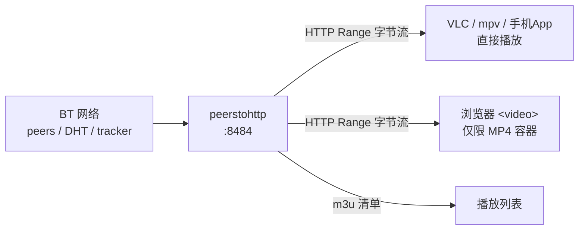

# peerstohttp 部署与启动手册

> 适用对象：本仓库当前快照（`vendor/` 已含两处可编译性补丁，见[附录](#10-附录依赖补丁)）
> 最后实测环境：Windows 11 + Go 1.27.0 + GCC 16.1.0（MSYS2）+ PowerShell
> 实测日期：2026-10-19

---

## 1 项目概览与访问模型

### 1.1 它是什么

`peerstohttp` 是一个**把 BitTorrent 转成 HTTP 流**的轻量网关：

- 你给它一个 magnet 链接或 info hash，它返回文件清单（json / m3u / html）；
- 你请求清单里的某个文件，它**一边从 BT 网络下载，一边通过 HTTP 把字节流吐给播放器**。

它自己不含 BT 协议实现，全部依赖 `github.com/anacrolix/torrent`。

### 1.2 三个 HTTP 端点

| 方法 | 路径 | 作用 |
|---|---|---|
| GET | `/list/{json\|m3u\|html}/{扩展名白名单}/{标签黑名单}/hash/{infoHash}` | 按 info hash 列文件 |
| GET | `/list/{json\|m3u\|html}/{扩展名白名单}/{标签黑名单}/magnet/{完整magnet}` | 按 magnet 列文件 |
| GET | `/content/{infoHash}/{路径...}` | 流式读取单个文件（支持 Range） |

- 白名单/黑名单填 `-` 表示不过滤，例如 `mp4,mkv` / `live,remix`。
- 另可选开启 `/debug/pprof/*`（启动加 `-profile`）。

### 1.3 数据流



### 1.4 一个必须先理解的概念：**边下边播是内建的**

`peerstohttp` 已实现 `io.ReadSeeker` + `http.ServeContent`，因此：

- 支持 HTTP `Range` 请求 → **播放器可以随意拖动进度条**；
- `SetResponsive()` 让未校验完成的分片也能先读；
- 预读窗口为文件大小的 10%（`http/helpers.go:160`），大文件会占较多内存。

所以「边下载边播放」**不需要**额外的 ffmpeg / HLS / 转码服务。

只有一种情况需要额外处理：**用浏览器 `<video>` 播放**。浏览器不支持 MKV 容器；若种子本身是 MP4（H.264/AAC），浏览器可直接播，无需任何额外组件。

---

## 2 前置条件矩阵

| 部署方式 | 需要安装 | 是否需要 C 编译器 | 适用场景 |
|---|---|---|---|
| **Windows 直接用现成 exe** | 无 | 否 | 只想跑起来 |
| **Windows 从源码编译** | Go 1.19+、gcc（MSYS2 / TDM-GCC）、3 个运行库 DLL | 是（CGO） | 需要改代码 / 换机器重建 |
| **Linux 从源码编译** | Go 1.19+、`build-essential`（含 gcc/g++/make） | 是（CGO） | 服务器长期运行 |
| **Docker / docker-compose** | Docker 20.10+（Windows 需 Docker Desktop + WSL2） | 否（镜像内已含） | 免环境、可迁移 |

### 2.1 必须知道的硬约束

- **CGO 不能关**：`go-libutp` 是 C/C++ 代码，`CGO_ENABLED=0` 一定失败。
- **`-mod=vendor` 不能省**：仓库自带 `vendor/`，不加此参数 Go 会尝试联网拉依赖。
- **Go 版本**：本仓库 `go.mod` 声明 `go 1.19`。因为已打补丁，**Go 1.21 ~ 1.27 均可编译**；若你重置了 `vendor/`，则必须用 **Go ≤ 1.20**（原因见附录）。
- **GCC 版本**：因为已打补丁，**GCC 15/16（默认 C23）也能编译**；若重置 `vendor/`，需 GCC ≤ 14 或手动加 `-std=gnu17`。

### 2.2 端口约定

| 端口 | 用途 | 说明 |
|---|---|---|
| `8484` | HTTP 服务 | 本文统一用它，避开 Windows 常被占用的 80 |
| `6881` | BT 监听（TCP + UDP） | 固定端口有利于连通性；防火墙需放行两个协议 |

---

## 3 Windows 部署

### 3.0 先判断走哪条路

```powershell
cd C:/path/to/peerstohttp-master
Test-Path .\peerstohttp.exe     # True -> 走 3.1；False -> 走 3.2
```

---

### 3.1 路径 A：直接使用现成产物（无需任何开发环境）

#### 需要同目录存在 4 个文件

```text
peerstohttp-master/
├── peerstohttp.exe            # 主程序（约 35 MB）
├── libstdc++-6.dll            # 必需，否则双击无反应
├── libgcc_s_seh-1.dll         # 必需
├── libwinpthread-1.dll        # 必需
└── DEPLOY.md
```

这 3 个 DLL 来自 MSYS2（`C:\msys64\mingw64\bin\`）。**移动 exe 时必须把它们一起带走**，否则进程会静默退出、连报错都没有。

#### 启动

```powershell
cd C:/path/to/peerstohttp-master
.\peerstohttp.exe -port=8484 -port-torr=6881 -dir=C:/bt-data
```

首次运行会弹 Windows 防火墙窗口，**「专用网络」和「公用网络」都勾上**。

#### 后台启动（不占用当前终端）

```powershell
Start-Process -FilePath ".\peerstohttp.exe" `
  -ArgumentList "-port=8484","-port-torr=6881","-dir=C:/bt-data" `
  -WorkingDirectory (Get-Location) -WindowStyle Hidden
```

#### 停止

```powershell
Get-Process peerstohttp -ErrorAction SilentlyContinue | Stop-Process -Force
```

#### 防火墙放行（可选，管理员权限）

```powershell
New-NetFirewallRule -DisplayName "peerstohttp BT TCP" -Direction Inbound -Protocol TCP -LocalPort 6881 -Action Allow
New-NetFirewallRule -DisplayName "peerstohttp BT UDP" -Direction Inbound -Protocol UDP -LocalPort 6881 -Action Allow
```

---

### 3.2 路径 B：从源码编译

#### 步骤 1：安装 Go

```powershell
winget install -e --id GoLang.Go
```

装完**新开一个终端**验证：

```powershell
go version        # 需要 1.19 或更高
```

#### 步骤 2：安装 gcc（CGO 必需）

任选一种：

```powershell
# 方案 1：MSYS2（推荐）
winget install -e --id MSYS2.MSYS2
C:\msys64\usr\bin\pacman.exe -S --noconfirm mingw-w64-x86_64-gcc
# 然后把 C:\msys64\mingw64\bin 加入 PATH

# 方案 2：Chocolatey
choco install mingw -y

# 方案 3：TDM-GCC 图形安装包
# https://jmeubank.github.io/tdm-gcc/download/
```

验证：

```powershell
gcc --version     # 需要 64 位；GCC 10 ~ 16 均可（本仓库已兼容 C23）
```

> 若 `where.exe gcc` 出现多条路径，**把准备用的那条放到 PATH 最前**，否则可能用到另一个版本。

#### 步骤 3：编译

```powershell
cd C:/path/to/peerstohttp-master

# 按自己的实际路径调整
$env:PATH = "D:\Go\bin;C:\msys64\mingw64\bin;" + $env:PATH
$env:CGO_ENABLED = "1"
$env:CC = "gcc"

go build -mod=vendor -o peerstohttp.exe .\cmd
```

- **成功标志**：没有任何输出，当前目录出现 `peerstohttp.exe`。
- 首次编译约 1~3 分钟；`go clean -cache` 后重编会更久。

#### 步骤 4：复制运行库 DLL

```powershell
foreach ($d in @("libstdc++-6.dll","libgcc_s_seh-1.dll","libwinpthread-1.dll")) {
    Copy-Item "C:\msys64\mingw64\bin\$d" ".\$d" -Force
}
```

不做这一步，exe 只能在装有 MSYS2 环境的机器上跑。

#### 步骤 5：启动

同 [3.1 启动](#启动)。

---

### 3.3 一键脚本 `start.ps1`

仓库根目录已提供脚本，自动完成「定位工具链 → 检查产物 → 创建下载目录 → 端口占用检查 → 按参数启动 → 打印可用 URL」：

```powershell
cd C:/path/to/peerstohttp-master

# 前台运行（Ctrl+C 停止）
.\start.ps1

# 自定义端口与目录
.\start.ps1 -Port 9000 -TorrentPort 51413 -Dir D:/bt-data

# 后台运行 / 停止
.\start.ps1 -Background
.\start.ps1 -Stop
```

#### 脚本如何定位 MSYS2 / GCC（不写死路径）

按以下顺序探测，第一个含 `gcc.exe` 的目录胜出：

| 顺序 | 来源 | 示例 |
|---|---|---|
| 1 | `-MingwBin` 参数 | `.\start.ps1 -MingwBin "D:\msys64\mingw64\bin"` |
| 2 | 环境变量 `PEERSTOHTTP_MINGW_BIN` | `"D:\msys64\mingw64\bin"` |
| 3 | PATH 上已有的 `gcc.exe` | 反推其所在目录 |
| 4 | 环境变量 `CC` 指向的编译器 | `CC=C:\tools\mingw64\bin\gcc.exe` |
| 5 | `MSYS2_ROOT` / `MSYS2_HOME` | `"D:\msys64"`，再自动试 `mingw64` / `ucrt64` / `clang64` / `mingw32` |

全部落空时脚本只打印告警并继续启动，**不会退回任何写死的默认路径**。持久化设置示例（改完需重开终端才生效）：

```powershell
[Environment]::SetEnvironmentVariable("PEERSTOHTTP_MINGW_BIN", "D:\msys64\mingw64\bin", "User")
[Environment]::SetEnvironmentVariable("MSYS2_ROOT",            "D:\msys64",              "User")
```

`-Dir` 与 `-Exe` 同样支持环境变量兜底：`PEERSTOHTTP_DIR`、`PEERSTOHTTP_EXE`。

#### 关于运行库 DLL

脚本**不再把 3 个 DLL 复制进仓库目录**，而是把工具链的 `bin` 前置到当前进程的 `PATH`，由 Windows 在启动 exe 时自行解析依赖（Windows 的 DLL 搜索顺序包含 `PATH`）。因此：

- 仓库始终保持干净，`git status` 里不会出现 `libstdc++-6.dll` 之类的产物；
- 只有「双击 exe 独立运行」或「把整个目录打包给别人」时，才需要按 3.2 步骤 4 把 DLL 放到 exe 同目录。

脚本 **不修改系统环境变量**，`PATH` 改动只作用于自身进程及其启动的子进程，退出即失效。

首次运行如遇 PowerShell 执行策略拦截，用：

```powershell
powershell -ExecutionPolicy Bypass -File .\start.ps1
```

---

## 4 Linux 部署

> 与 Windows 的差异只有三处：依赖包名、二进制文件名（无 `.exe`）、后台运行方式。
> **编译参数完全相同**（`CGO_ENABLED=1` + `go build -mod=vendor ./cmd`）。

### 4.1 安装依赖

#### Debian / Ubuntu

```bash
sudo apt update
sudo apt install -y build-essential wget
```

#### CentOS / RHEL / Rocky

```bash
sudo dnf groupinstall -y "Development Tools"
sudo dnf install -y wget tar
```

#### 安装 Go

系统仓库里的 Go 往往太旧，建议从官网装：

```bash
cd /tmp
wget https://go.dev/dl/go1.22.12.linux-amd64.tar.gz
sudo rm -rf /usr/local/go
sudo tar -C /usr/local -xzf go1.22.12.linux-amd64.tar.gz

echo 'export PATH=$PATH:/usr/local/go/bin' >> ~/.bashrc
source ~/.bashrc

go version    # 需要 >= 1.19
```

> 本仓库 `vendor/` 已打补丁，**Go 1.21 ~ 1.27 均可编译**。若你执行过 `go mod vendor` 重置了依赖，则必须用 Go ≤ 1.20。

### 4.2 编译

```bash
cd /opt/peerstohttp        # 换成你的实际路径
export CGO_ENABLED=1
export CC=gcc
go build -mod=vendor -o peerstohttp ./cmd
```

成功标志：无输出，当前目录出现 `peerstohttp`（约 30~35 MB）。

```bash
chmod +x peerstohttp
./peerstohttp -help
```

**不要跨平台交叉编译**：本项目依赖 CGO，在 Windows 上交叉编译 Linux 二进制需要完整的 Linux 交叉工具链，最省事的做法是直接在 Linux 机器上编译。

### 4.3 运行

#### 前台（调试用）

```bash
mkdir -p /data/bt
./peerstohttp -port=8484 -port-torr=6881 -dir=/data/bt
```

#### 后台（nohup）

```bash
nohup ./peerstohttp -port=8484 -port-torr=6881 -dir=/data/bt > peerstohttp.log 2>&1 &
echo $! > peerstohttp.pid

# 停止
kill $(cat peerstohttp.pid)
```

#### 开机自启（systemd，推荐）

创建 `/etc/systemd/system/peerstohttp.service`：

```ini
[Unit]
Description=peerstohttp - BitTorrent to HTTP gateway
After=network-online.target
Wants=network-online.target

[Service]
Type=simple
User=media
Group=media
WorkingDirectory=/opt/peerstohttp
ExecStart=/opt/peerstohttp/peerstohttp -port=8484 -port-torr=6881 -dir=/data/bt -cache-capacity=0
Restart=on-failure
RestartSec=5
LimitNOFILE=65535

[Install]
WantedBy=multi-user.target
```

启用与查看：

```bash
sudo systemctl daemon-reload
sudo systemctl enable --now peerstohttp
sudo systemctl status peerstohttp

# 实时日志
sudo journalctl -u peerstohttp -f
```

> 注意：`-dir` 指向的目录，其属主必须是 `User=` 指定的用户，否则会因权限问题启动失败。

### 4.4 防火墙

#### ufw（Ubuntu/Debian）

```bash
sudo ufw allow 8484/tcp
sudo ufw allow 6881/tcp
sudo ufw allow 6881/udp
sudo ufw reload
```

#### firewalld（CentOS/RHEL）

```bash
sudo firewall-cmd --permanent --add-port=8484/tcp
sudo firewall-cmd --permanent --add-port=6881/tcp
sudo firewall-cmd --permanent --add-port=6881/udp
sudo firewall-cmd --reload
```

> 只映射 HTTP 端口也能用（纯靠 DHT 找 peer），但**放行 6881 的 TCP+UDP 能显著提升连通率**。

---

## 5 容器部署（Docker / docker-compose）

### 5.0 前提

| 系统 | 需要 |
|---|---|
| Windows 10/11 | **Docker Desktop**（基于 WSL2，需先启用 WSL2）；无法直接装 Docker Engine |
| macOS | Docker Desktop |
| Linux | `docker` + `docker compose` 插件（`docker-compose-plugin`） |

容器内服务**默认监听 80 端口**（`settings` 里 `-port` 的默认值），因此映射到宿主机时写 `8484:80`。

---

### 5.1 直接用官方镜像（最快）

```bash
docker run -d --name peerstohttp \
  -p 8484:80 \
  -p 6881:6881/tcp \
  -p 6881:6881/udp \
  -v peerstohttp-data:/downloads \
  winpooh32/peerstohttp:latest \
  -dir=/downloads -port-torr=6881
```

Windows PowerShell 写法（续行用反引号）：

```powershell
docker run -d --name peerstohttp `
  -p 8484:80 `
  -p 6881:6881/tcp `
  -p 6881:6881/udp `
  -v peerstohttp-data:/downloads `
  winpooh32/peerstohttp:latest `
  -dir=/downloads -port-torr=6881
```

查看状态与日志：

```bash
docker ps
docker logs -f peerstohttp
```

---

### 5.2 从本仓库构建镜像

好处：**会带上 `vendor/` 里的两处编译补丁**（见[附录](#10-附录依赖补丁)），不依赖上游镜像的构建时间点。

```bash
cd /path/to/peerstohttp-master
docker build -t peerstohttp:local .
```

然后替换上面命令里的镜像名：

```bash
docker run -d --name peerstohttp \
  -p 8484:80 -p 6881:6881/tcp -p 6881:6881/udp \
  -v peerstohttp-data:/downloads \
  peerstohttp:local -dir=/downloads -port-torr=6881
```

> `Dockerfile` 是多阶段构建：`golang:alpine` + `build-base` 编译，产物放进 `alpine` 运行镜像并补装 `libstdc++ libgcc`。因此**不需要你本机有 gcc**。

---

### 5.3 docker-compose

仓库根目录的 `docker-compose.yml` **已修正为可直接执行**（修正内容见 5.4）。

```bash
cd /path/to/peerstohttp-master

docker compose up -d          # 启动
docker compose ps             # 状态
docker compose logs -f        # 实时日志
docker compose restart        # 重启
docker compose down           # 停止并删除容器（保留数据卷）
docker compose down -v        # 连数据卷一起删（下载的数据会丢失）
```

如果 Docker 版本较老，把 `docker compose` 换成 `docker-compose`。

---

### 5.4 仓库原版 compose 的两个坑（已修正）

| 原写法 | 问题 | 修正后 |
|---|---|---|
| `image: WinPooh32/peerstohttp` | 镜像仓库名**不允许大写**，Docker 直接报 `invalid reference format` | `image: winpooh32/peerstohttp:latest` |
| `network_mode: host` | **Docker Desktop（Windows/macOS）不支持 host 网络**，容器起不来或网络不通 | 删除，改为 `ports` 映射 |
| `version: "2.4"` | Compose V2 已废弃该字段，会打印警告 | 删除 |
| 未挂载数据卷 | 容器重启后下载数据丢失 | 增加命名卷 `peerstohttp-data:/downloads` |
| 未固定 `-port-torr` | 每次随机端口，宿主机无法映射，连通性差 | 固定 `-port-torr=6881` 并映射 TCP/UDP |

> 如果你确定在 **Linux 主机** 上运行，也可以主动改回 `network_mode: host`（此时无需 `ports`），网络性能略好，且 BT 端口无需映射。但 `network_mode` 与 `ports` 不能同时使用。

---

### 5.5 数据卷管理

```bash
docker volume ls
docker volume inspect peerstohttp-data     # 查看挂载点（Linux 下通常在 /var/lib/docker/volumes/...）
docker volume rm peerstohttp-data          # 必须先 down -v 或删除容器
```

想直接看下载到的文件，也可以改成绑定挂载：

```yaml
    volumes:
      - /data/bt:/downloads        # Linux
      # - D:/bt-data:/downloads    # Windows Docker Desktop
```

---

### 5.6 容器运行常见问题

| 现象 | 原因 | 处理 |
|---|---|---|
| `docker compose up` 报 `invalid reference format` | 沿用了原版的大写镜像名 | 改成 `winpooh32/peerstohttp:latest` |
| 容器起来又立刻退出 | 参数错误或 `-dir` 无写权限 | `docker logs peerstohttp` 看具体报错 |
| 宿主机访问 `127.0.0.1:8484` 无响应 | 只映射了容器内 80，却把 `-port` 改成了别的值 | 让 `-port` 与 `ports` 右侧保持一致 |
| 能列清单但下载速度为 0 | 6881 未映射 / 防火墙拦截 | 确认 `-p 6881:6881/tcp` 与 `/udp` 都在 |

---

## 6 参数速查

所有参数都是命令行 flag，定义在 `settings/settings.go:27`。启动时直接追加，例如：

```powershell
.\peerstohttp.exe -port=8484 -dir=C:/bt-data
```

### 6.1 网络与端口

| 参数 | 默认值 | 推荐值 | 说明 |
|---|---|---|---|
| `-host` | `0.0.0.0` | `0.0.0.0` | HTTP 监听地址。只给自己用可改 `127.0.0.1` |
| `-port` | `80` | **`8484`** | HTTP 端口。Windows 上 80 常被 `http.sys` 占用 |
| `-port-torr` | `0` | **`6881`** | BT 监听端口。`0` = 随机；固定值便于端口映射 |
| `-http-proxy` | 空 | 视网络 | 给 tracker / 种子源走的 HTTP 代理，如 `http://127.0.0.1:7890` |

### 6.2 存储

| 参数 | 默认值 | 推荐值 | 说明 |
|---|---|---|---|
| `-dir` | 空 | **必填** | 下载目录。**留空会用系统临时目录，且进程退出时整个删除**（`app/app.go:193`） |
| `-cache-capacity` | `10240`（MiB ≈ 10 GiB） | `2048` 或 `0` | 见下方说明 |

> **`-cache-capacity` 是"总量上限"，不是"加速开关"。**
> 大于 0：走块级 LRU 缓存，超过容量**会淘汰旧文件**（`app/init.go:107`）。
> 等于 0：改为普通落盘，文件永久保留。

### 6.3 限速与连接

| 参数 | 默认值 | 推荐值 | 说明 |
|---|---|---|---|
| `-down-rate` | `0` | `0` | 下载限速，单位 **KiB/s**，`0` = 不限 |
| `-up-rate` | `0` | `0` | 上传限速，单位 KiB/s，`0` = 不限 |
| `-max-connections` | `50` | `50` | 单种子最大连接数 |

### 6.4 网络协议开关

| 参数 | 默认值 | 说明 |
|---|---|---|
| `-no-dht` | `false` | 关 DHT。关了之后严重依赖 tracker，**一般不要关** |
| `-no-upnp` | `false` | 关 UPnP 自动端口映射 |
| `-no-tcp` | `false` | 关 TCP（仅保留 uTP） |
| `-no-utp` | `false` | 关 uTP（仅保留 TCP）。注意：**不影响编译**，CGO 仍然需要 |
| `-no-ipv4` | `false` | 关 IPv4 |
| `-no-ipv6` | `false` | 关 IPv6 |
| `-force-encryption` | `false` | 强制 MSE/RC4 加密，某些网络环境需要 |

### 6.5 调试

| 参数 | 默认值 | 说明 |
|---|---|---|
| `-json-logs` | `false` | 日志改为 JSON 格式 |
| `-torr-debug` | `false` | 打开 BT 底层日志，排障时用 |
| `-profile` | `false` | 开启 `/debug/pprof/` 性能剖析 |

### 6.6 一套完整的推荐参数

```powershell
.\peerstohttp.exe -port=8484 -port-torr=6881 -dir=C:/bt-data -cache-capacity=0 -max-connections=50
```

```bash
./peerstohttp -port=8484 -port-torr=6881 -dir=/data/bt -cache-capacity=0 -max-connections=50
```

---

## 7 验证清单

按 **服务存活 → 清单接口 → 文件流（可拖动）** 三层依次确认。

> 以下状态码均为本机实测结果。示例统一使用公开测试种子 **Sintel**：
> `08ada5a7a6183aae1e09d831df6748d566095a10`

### 7.1 第一层：服务是否活着

```powershell
curl.exe -s -o NUL -w "HTTP %{http_code}`n" --max-time 10 "http://127.0.0.1:8484/list/json/-/-/hash/zzz"
```

```bash
curl -s -o /dev/null -w "HTTP %{http_code}\n" --max-time 10 "http://127.0.0.1:8484/list/json/-/-/hash/zzz"
```

**预期**：`HTTP 400`

| 实际结果 | 含义 |
|---|---|
| `400` | ✅ 服务正常，且 hash 校验生效 |
| `000` / 连接被拒绝 | 服务没启动，或端口不对 |
| 卡住不返回 | 进程在但卡在等元数据（换用 7.2 观察） |

### 7.2 第二层：清单接口

```powershell
curl.exe -s --max-time 60 "http://127.0.0.1:8484/list/json/mp4/-/hash/08ada5a7a6183aae1e09d831df6748d566095a10"
```

**预期**：`HTTP 200`，返回类似

```json
{
  "header": { "hash": "08ada5a7a6183aae1e09d831df6748d566095a10", "name": "Sintel", "files": 11 },
  "content": [
    { "name": "Sintel", "name_orig": "Sintel.mp4", "ext": ".mp4",
      "mime": "video/mp4", "size": 129241752,
      "path": ["Sintel.mp4"], "tags": [] }
  ]
}
```

> 首次请求会阻塞数秒到数十秒，因为要等 BT 网络返回种子元数据（`app/app.go:249` 的 `<-t.GotInfo()`）。期间 HTTP 无超时保护。

### 7.3 第三层：m3u 清单

```powershell
curl.exe -s --max-time 60 "http://127.0.0.1:8484/list/m3u/mp4/-/hash/08ada5a7a6183aae1e09d831df6748d566095a10"
```

**预期**：

```text
#EXTM3U
#EXTENC: UTF-8
#EXTINF:-1,Sintel
http://<你的Host>/content/08ada5a7a6183aae1e09d831df6748d566095a10/Sintel/Sintel.mp4
```

### 7.4 第四层：文件流与拖动（关键）

用 m3u 里那条链接（**注意里面带了 `Sintel/` 这一层**）：

```powershell
curl.exe -s -o NUL -D - -H "Range: bytes=1000-2023" --max-time 90 "http://127.0.0.1:8484/content/08ada5a7a6183aae1e09d831df6748d566095a10/Sintel/Sintel.mp4"
```

```bash
curl -s -o /dev/null -D - -H "Range: bytes=1000-2023" --max-time 90 "http://127.0.0.1:8484/content/08ada5a7a6183aae1e09d831df6748d566095a10/Sintel/Sintel.mp4"
```

**预期响应头**（实测）：

```text
HTTP/1.1 206 Partial Content
Accept-Ranges: bytes
Content-Disposition: filename="Sintel.mp4"
Content-Length: 1024
Content-Range: bytes 1000-2023/129241752
Content-Type: video/mp4
```

看到 `206` + `Content-Range` 就说明**边下边播与进度条拖动都已可用**。

| 实际结果 | 含义 |
|---|---|
| `206` | ✅ 一切正常 |
| `200` 且 `Content-Length: 0` | ❌ 路径缺了种子名那一层，被当成"请求目录"（见 8.1） |
| `500` | 找不到该文件（路径与种子内路径不完全一致） |

### 7.5 用播放器确认

```powershell
# 直接把 m3u 的 URL 丢给 VLC
& "C:\Program Files\VideoLAN\VLC\vlc.exe" "http://127.0.0.1:8484/list/m3u/mp4/-/hash/08ada5a7a6183aae1e09d831df6748d566095a10"
```

验证点：能起播、能拖到任意位置、拖完继续播。

---

## 8 已知问题与使用规则

### 8.1 【最常见】URL 路径必须带「种子名」这一层

```text
✅ /content/{infoHash}/{种子名}/{种子内路径}
❌ /content/{infoHash}/{种子内路径}
```

原因：`http/api.go:110` 用

```go
if t.Info().IsDir() && strings.Count(path, "/") == 0
```

判断"这是不是在请求目录"，而目录分支 `serveTorrentDir`（`http/helpers.go:63`）**整体被注释、直接 `return err`（nil）**，于是返回 **200 + 空 body**，既不报错也没有数据。

连带后果：`/list/json` 返回的 `content[].path` **不含种子名**，不能直接拼成可播 URL；**应当使用 `/list/m3u/...` 生成的链接**，或手动补上种子名。

### 8.2 `-dir` 留空 → 数据会被删除

`-dir` 为空时使用系统临时目录，而 `app.Close()` 会 `os.RemoveAll(临时目录)`（`app/app.go:193`）。**部署时必须显式指定 `-dir`。**

### 8.3 `-cache-capacity` 是上限，不是加速

大于 0 时走 `filecache` 块级 LRU（`app/init.go:107`），超出容量会**淘汰已下载文件**。想让文件永久保留请设 `-cache-capacity=0`。

### 8.4 首次请求可能长时间无响应

`trackContext` 会阻塞在 `<-t.GotInfo()`（`app/app.go:249`），而 `http.Server` 未设置 `ReadTimeout/WriteTimeout`。死种或没有 peer 时请求会一直挂着，只能靠客户端断开或 `curl --max-time` 兜底。

### 8.5 预读会占用较多内存

`reader.SetReadahead((size * 10) / 100)`（`http/helpers.go:160`）按文件大小的 10% 预读。对 4 GB 文件意味着最高约 400 MB 缓冲。大文件播放时注意内存水位。

### 8.6 并发下 m3u 可能退化为 JSON

`http/render/responder.go:157` 的中间件修改的是 `chi/render` 的**包级全局变量** `render.Respond`，并在请求结束时还原。并发请求会互相覆盖，偶发出现"请求 m3u 却返回 JSON"。属于已知缺陷，单用户场景基本不触发。

### 8.7 种子列表会持久化，且没有删除入口

元数据（含 tracker 列表）写入 `{dir}/.app.bolt.db`，重启自动恢复（`app/app.go:215`）。项目**没有** Drop/删除种子的 API，想清理只能停服务后删除该文件。

### 8.8 不要期望浏览器直接播 MKV

浏览器不支持 MKV 容器。若种子里是 MP4（H.264/AAC），`<video>` 可直接指向 `/content/...`；否则需要 ffmpeg 转封装。**这与"边下边播"是两回事**：后者 `peerstohttp` 已内建。

---

## 9 错误对照表

### 9.1 编译期

| 报错 | 原因 | 解决 |
|---|---|---|
| `cannot define new methods on non-local type *C.utp_callback_arguments` | Go 1.21+ 禁止在 cgo 类型别名上定义方法；未打补丁的 `go-libutp v1.2.0` 会触发 | 使用**本仓库**（已打补丁）；或改用 Go ≤ 1.20 |
| `two or more data types in declaration specifiers` / `utp_types.h:120: typedef uint8 bool;` | GCC 15+ 默认 `-std=gnu23`，`bool` 成为关键字 | 使用**本仓库**（已打补丁）；或 `$env:CGO_CFLAGS="-std=gnu17"`；或换 GCC ≤ 14 |
| `exec: "gcc": executable file not found in %PATH%` | 没有 C 编译器 / 不在 PATH | Windows 装 MSYS2 或 TDM-GCC；Linux 装 `build-essential` |
| `go: inconsistent vendoring in ...` | `vendor/` 与 `go.mod` 不匹配 | `go build -mod=mod`（会联网拉依赖）或 `go mod vendor` 重建 |
| `undefined: C.xxx` / `could not determine kind of name for C.xxx` | cgo 解析头文件失败，通常是上面某个 C 错误的下游 | 先修 C 层错误，不要单独处理这一条 |
| 链接时报 `undefined reference to ...` | 缺少运行库 | Windows 复制 3 个 DLL；Linux 装 `libstdc++` |

### 9.2 运行期

| 现象 | 原因 | 解决 |
|---|---|---|
| 双击 exe 无反应 / 进程秒退、无任何日志 | 缺 `libstdc++-6.dll` 等 3 个运行库 | 把 3 个 DLL 放到 exe 同目录（3.2 步骤 4） |
| `listen tcp :80: bind: permission denied` | 默认端口 80 被占用或无权限 | `-port=8484` |
| `FTL new app error="new torrent client: first listen: listen tcp4 :6881: bind: Only one usage of each socket address..."` | **已有另一个实例在运行**，占用了 BT 端口 | `Get-Process peerstohttp \| Stop-Process -Force` 后再启动（同一时刻只能跑一个实例） |
| 列表接口一直不返回 | 没有 peer / 死种 / 防火墙拦截 | 放行 6881 TCP+UDP；加 `-torr-debug` 看日志；换热门种子测试 |
| `/content/...` 返回 200 但内容空 | 路径缺种子名（见 8.1） | 用 `/list/m3u/...` 给出的链接 |
| `/content/...` 返回 500 或找不到文件 | 路径与种子内路径不完全一致 | 从 `/list/json` 的 `path` 复制，并补上种子名 |
| 中文/空格文件名请求失败 | 未做 URL 编码 | 用 m3u 里的已编码链接 |
| 播一会儿文件消失 | `-cache-capacity` 触发 LRU 淘汰（见 8.3） | 设 `-cache-capacity=0` |
| 重启后种子列表还在但文件没了 | 元数据在 bbolt 里，数据文件被淘汰或删除 | 属正常现象，重新下载即可 |
| 上传占用带宽过高 | 默认 `cfg.Seed = true` | `-up-rate=xxx`（KiB/s）限速 |

---

## 10 附录：依赖补丁

> 本章解释「为什么这份代码能编译」。如果你重置了 `vendor/`，需要按本章重新打补丁，或者改用旧工具链（10.4）。

### 10.1 背景：两个独立的年代问题

`github.com/anacrolix/go-libutp v1.2.0` 是 2022 年前后的代码，它同时踩了两个**互不相关**的新工具链变更：

| 编号 | 触发条件 | 触发点 | 表现 |
|---|---|---|---|
| ① | **GCC ≥ 15**（默认 `-std=gnu23`） | `utp_types.h` 的 `typedef uint8 bool;` | C23 里 `bool` 是关键字，`two or more data types in declaration specifiers` |
| ② | **Go ≥ 1.21** | `go-libutp` 的 7 个方法 | Go 禁止在 cgo 生成的**类型别名**上定义方法，`cannot define new methods on non-local type` |

两个坑会**先后出现**：修好 ① 才会看到 ②。这就是为什么"只加 `-std=gnu17`"看起来无效——它只解决了第一个。

### 10.2 补丁一：`utp_types.h`

文件：`vendor/github.com/anacrolix/go-libutp/utp_types.h`（约 119~125 行）

```diff
 #ifndef __cplusplus
-typedef uint8 bool;
+#if !defined(__STDC_VERSION__) || __STDC_VERSION__ < 202311L
+#ifndef bool
+typedef uint8 bool;
+#endif
+#endif
 #endif
```

C23 下跳过 typedef，直接使用内置 `bool`（1 字节，与 `uint8` 布局一致，**ABI 不变**）；C17 及以下行为保持原样。

### 10.3 补丁二：把 7 个方法改成普通函数

文件：`vendor/github.com/anacrolix/go-libutp/{callbacks.go, utp.go, socket.go}`

| 原方法（非法） | 改成普通函数 |
|---|---|
| `func (a *C.utp_callback_arguments) bufBytes() []byte` | `func cbBufBytes(a *C.utp_callback_arguments) []byte` |
| `func (a *C.utp_callback_arguments) state() C.int` | `func cbState(a *C.utp_callback_arguments) C.int` |
| `func (a *C.utp_callback_arguments) error_code() C.int` | `func cbErrorCode(a *C.utp_callback_arguments) C.int` |
| `func (a *C.utp_callback_arguments) address() *C.struct_sockaddr` | `func cbAddress(a *C.utp_callback_arguments) *C.struct_sockaddr` |
| `func (a *C.utp_callback_arguments) addressLen() C.socklen_t` | `func cbAddressLen(a *C.utp_callback_arguments) C.socklen_t` |
| `func (ctx *C.utp_context) setCallbacks()` | `func setCallbacks(ctx *C.utp_context)` |
| `func (ctx *C.utp_context) setOption(opt Option, val int) int` | `func setOption(ctx *C.utp_context, opt Option, val int) int` |

调用点同步修改（共 11 处）：

```diff
# callbacks.go
-	b := a.bufBytes()
+	b := cbBufBytes(a)
-	structSockaddrToUDPAddr(a.address(), &sendToUdpAddr)
+	structSockaddrToUDPAddr(cbAddress(a), &sendToUdpAddr)
-	err := errorForCode(a.error_code())
+	err := errorForCode(cbErrorCode(a))
-	libStateName(a.state())
+	libStateName(cbState(a))
-	switch a.state() {
+	switch cbState(a) {
-	panic(a.state)
+	panic(cbState(a))

# socket.go
-	ctx.setCallbacks()
+	setCallbacks(ctx)
-	ctx.setOption(C.UTP_LOG_NORMAL, 1)
+	setOption(ctx, C.UTP_LOG_NORMAL, 1)
-	ctx.setOption(C.UTP_LOG_MTU, 1)
+	setOption(ctx, C.UTP_LOG_MTU, 1)
-	ctx.setOption(C.UTP_LOG_DEBUG, 1)
+	setOption(ctx, C.UTP_LOG_DEBUG, 1)
```

> 也可以用更通用的一条命令验证是否漏改：
> ```powershell
> Select-String -Path .\vendor\github.com\anacrolix\go-libutp\*.go -Pattern 'func \(.*\*C\.'
> ```
> 没有任何输出即为干净。

### 10.4 如果 `vendor/` 被重置了怎么办

**方案 A（推荐）：重新打上面的补丁**，然后照常构建、不需要降级任何工具链。

**方案 B：改用旧工具链，完全不动源码**

| 组件 | 要求 |
|---|---|
| Go | **≤ 1.20**（1.21+ 会触发 ②） |
| GCC | **≤ 14**（15+ 会触发 ①） |

Windows 上并存安装 Go 1.20 的示例：

```powershell
$zip = "$env:USERPROFILE\Downloads\go1.20.14.zip"
Invoke-WebRequest -Uri "https://mirrors.aliyun.com/golang/go1.20.14.windows-amd64.zip" -OutFile $zip
Expand-Archive -Path $zip -DestinationPath "C:\Go1.20" -Force

cd C:/path/to/peerstohttp-master
$env:GOROOT = "C:\Go1.20\go"     # 关键：否则会串到你现有的 Go
$env:PATH   = "C:\Go1.20\go\bin;" + $env:PATH
$env:CGO_ENABLED = "1"

go version                       # 应显示 go1.20.14
go build -mod=vendor -o peerstohttp.exe .\cmd
```

Linux 同理：

```bash
cd /tmp
wget https://go.dev/dl/go1.20.14.linux-amd64.tar.gz
sudo rm -rf /usr/local/go1.20
sudo mkdir -p /usr/local/go1.20
sudo tar -C /usr/local/go1.20 --strip-components=1 -xzf go1.20.14.linux-amd64.tar.gz
export PATH=/usr/local/go1.20/bin:$PATH
```

### 10.5 补丁是否会影响运行行为

不影响。两处改动都是**编译期**问题：

- `bool` 仍是 1 字节，结构体布局不变；
- 方法改函数只是去掉接收者，调用语义完全相同，不改变内存布局与调用约定。

实测结果：编译产物可正常运行，`/list/json`、`/list/m3u`、`Range` 206 均验证通过。
