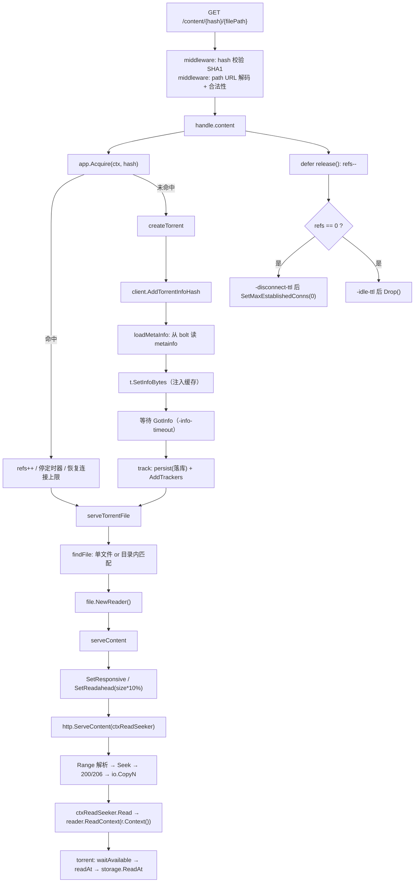

# 架构

`peerstohttp` 是一个把 BitTorrent 转成 HTTP 流的小服务：接收 info hash 或 magnet，返回文件清单，然后按 HTTP Range 请求边下载边输出。

代码量不大，但横跨三层：HTTP 层、种子生命周期层、BT 内核（vendored `anacrolix/torrent`）。本文说明这三层怎么衔接，以及几个容易被忽略的全局约束。

## 1. 分层

| 层 | 目录 | 职责 |
|---|---|---|
| 进程入口 | `cmd/` | 组装路由与中间件、启动 HTTP、处理退出信号、可选挂载 pprof |
| 配置 | `settings/` | 全部启动参数（flag）与单位换算 |
| HTTP | `http/` | chi 路由、路径参数校验中间件、`/list` 与 `/content` 两个 handler、Playlist 渲染 |
| 应用 | `app/` | 持有 torrent client 与 bbolt；`registry.go` 是**创建与回收种子的唯一入口** |
| BT 内核 | `vendor/github.com/anacrolix/torrent` | swarm、分片调度、peer 连接、storage 抽象 |
| 存储 | `vendor/.../storage`、`missinggo/v2/filecache` | 分片落盘（资源分片或普通文件） |

依赖方向是单向的：`http → app → (torrent client)`。`app` 不 import `http`，torrent 库也不回调 `app`，因此不存在反向持锁路径（这一点在 [torrent-lifecycle.md](torrent-lifecycle.md) 的锁顺序一节会用到）。

## 2. 启动链路

```
main()
 ├─ application.New(settings.Service)
 │   ├─ p2p(cfg)          // 构建 torrent.ClientConfig 并 NewClient
 │   ├─ db({dir}/.app.bolt.db)
 │   └─ go load()         // 只统计元数据缓存，不加载任何种子
 ├─ chi.NewRouter + middleware(RequestID/Logger/Recoverer/CORS)
 ├─ peershttp.RouteApp(router, app)
 ├─ if -profile { registerProfiler() }   // /debug/pprof/*
 └─ serveHTTP() / handleStopSignals()
```

几个配置点在 `app/init.go` 的 `p2p()` 里一次性写死的关系：

- `cfg.EstablishedConnsPerTorrent = -max-connections`
- `cfg.TorrentPeersLowWater = -max-connections`
- `cfg.Seed = true`（完成后继续上传）
- `-cache-capacity > 0` → `storage.NewResourcePieces(filecache)`，`≤ 0` → `storage.NewFile(dir)`

## 3. 一次 `/content` 的完整数据流



两个细节值得单独说明：

- **`Acquire` 返回的 `release` 必须调用**。它是引用计数的唯一减项，漏调会让种子永久停在 `refs >= 1`，两个定时器都不会启动。
- **读取的取消依赖请求上下文**。`torrent.Reader.Read` 内部固定使用 `context.Background()`，因此 HTTP 层包了一层 `ctxReadSeeker` 转发到 `ReadContext`。细节见 [content-streaming.md](content-streaming.md)。

## 4. 存储与持久化

两套存储，互不相干：

| 类型 | 位置 | 用途 |
|---|---|---|
| 分片数据 | `-dir` 下（`filecache` 结构或普通文件） | BT 分片；`-cache-capacity` 超过后按 LRU 淘汰 |
| 元数据缓存 | `{dir}/.app.bolt.db` 的 `torrent_info` bucket | 只存 bencoded metainfo，key 是 20 字节 info hash |

元数据缓存的角色是**加速**，不是"种子清单"：

- 启动时不读它、不预加载任何种子（`App.load()` 只打印条数）；
- 命中时由 `createTorrent` 注入 `SetInfoBytes`，省掉一次与 peer 的 metadata 交换；
- `-keep-meta=false` 时，种子被 `Drop()` 后连这条记录一起删掉。

> `SetInfoBytes` 对同一个种子是幂等的：库内部在 `t.info != nil` 时直接返回，不会重复构建分片结构。

## 5. 三个容易误解的全局约束

### 5.1 连接数上界 = 活跃种子数 × `-max-connections`

`EstablishedConnsPerTorrent` 是**每种子**配额，库里没有"全局已建立连接上限"。因此：

- 10 个活跃种子 × 50 = 上限 500 条；
- 这也是本项目引入两段式回收的直接动机：种子数必须被压住。

全局只有半开连接的限制：`TotalHalfOpenConns = 100`、`HalfOpenConnsPerTorrent = 25`（默认）。webseed 连接不计入 `maxEstablishedConns`。

### 5.2 `Seed = true` 会让"下完"不等于"安静"

只要该种子有任意一个完整分片，`wantConns()` 就为真，客户端会维持连接并继续上传。这是"内存涨上去不下降"的原始来源，也是 `-disconnect-ttl` / `-idle-ttl` 存在的原因。

### 5.3 分片预读由 reader 驱动

`serveContent` 里 `SetReadahead(size * 10 / 100)` 会把文件 10% 的范围标为"即将需要"，从而驱动分片优先级。对大文件，这会显著放大实际下载量；参数调整需与 `-max-connections` 匹配（详见 [content-streaming.md](content-streaming.md)）。

## 6. 相关文档

- 种子生命周期与回收：[torrent-lifecycle.md](torrent-lifecycle.md)
- 读取链路与取消：[content-streaming.md](content-streaming.md)
- 接口定义：[API.md](API.md)
- 启动参数与运维：[OPS.md](OPS.md)
