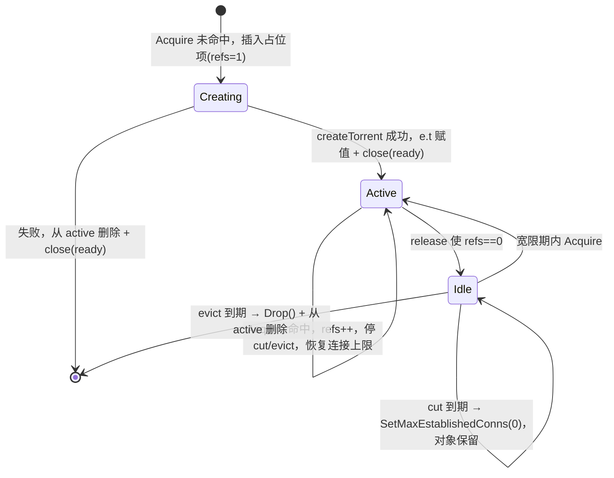

# 种子生命周期

本文说明 `app/registry.go` 的设计：为什么种子需要被回收、`trackedTorrent` 有哪几个状态、两个定时器分别做什么、锁怎么排、失败路径怎么处理。

## 1. 问题背景

改动前，`/content` 只调用 `client.AddTorrentInfoHash`，任何路径都不会调用 `Torrent.Drop()`。于是：

- `client.torrents` 里的种子只增不减；
- 每个种子持有 `pieces`（约 350 B/分片）、`requestPieceStates`、请求顺序 btree、storage 锁数组；
- `Seed = true` 时，只要有一个完整分片就长期维持最多 `-max-connections` 条 peer 连接（每条约 128 KiB 读缓冲 + 32 KiB 写缓冲）。

结论：常驻内存 ≈ 历史 hash 数 × (分片数 × 350 B + 连接数 × 160 KB)，且永不回落。

## 2. 数据结构

```go
type trackedTorrent struct {
	t        *torrent.Torrent
	refs     int
	lastUsed time.Time

	evict *time.Timer // 阶段二：refs 归零后 → Drop()
	cut   *time.Timer // 阶段一：refs 归零后 → 断开全部 peer 连接
	capped bool       // 是否已进入"阶段一"（连接上限被置零）

	ready chan struct{} // 首次创建结束时 close
	err   error         // close(ready) 之后可读，非 nil 表示创建失败
}
```

`App` 侧只有一张表加一把锁：

```go
active map[metainfo.Hash]*trackedTorrent
mu     sync.RWMutex
```

`active` 是**唯一**的种子索引。启动不再预加载，`/list` 与 `/content` 都走同一张表。

## 3. 状态机



关键点：**阶段一只断连接，不删对象**。这样宽限期内再次请求可以直接复用（元数据、分片完成状态、peer 地址池都还在），只有阶段二才会真正重建。

## 4. 两个定时器

| 定时器 | 参数 | 触发动作 | 目的 |
|---|---|---|---|
| `cut` | `-disconnect-ttl`（默认 15s，`0` = 立即） | `SetMaxEstablishedConns(0)` | 释放 peer 连接与缓冲区 |
| `evict` | `-idle-ttl`（默认 90s） | `Drop()` + 从 `active` 删除 | 释放按分片数计算的元数据 |

两条约束：

- `New()` 中会做 `disconnectTTL = min(disconnectTTL, idleTTL)`，避免"阶段一比阶段二还晚"，那样阶段一永远不会发生。
- 两个定时器都在 `refs == 0` 时启动；`Acquire` 命中时两者都 `Stop()` 并把指针置 `nil`。

为什么需要 `-disconnect-ttl`：播放器缓冲满时会主动中止 HTTP 请求，几百毫秒到几秒后再发新的 Range。如果一归零就把连接全砍了，每个间隙都要重新拨号 + 重排分片优先级，用户感知就是"续播/拖动变慢"。

## 5. 一次 acquire / release 的细节

### 5.1 Acquire（命中）

```
锁 app.mu
  refs++
  lastUsed = now
  evict.Stop(); evict = nil
  cut.Stop();    cut = nil
  if capped { t.SetMaxEstablishedConns(app.maxConns); capped = false }
解锁
  select { <-e.ready  |  <-ctx.Done() }
  if e.err != nil → release + 返回错误
  返回 (e.t, releaseFunc, nil)
```

`e.ready` 用于处理"创建尚未完成"的并发：第一个请求负责创建，其余请求等同一个结果，不会重复 `AddTorrent*`。

### 5.2 Acquire（未命中）

插入占位项后，**在不持锁的情况下**执行 `createTorrent`（可能阻塞数秒等元数据），完成后加锁写回 `e.t`/`e.err`，再 `close(e.ready)`。

注意顺序：先写字段、后 `close` —— 等待方通过 channel 关闭建立 happens-before，不会读到半成品。

### 5.3 release

```
锁 app.mu
  refs--
  if refs > 0 → 返回
  if 未 capped 且 cut == nil:
      disconnectTTL <= 0 ? cutConnsLocked(e) : cut = AfterFunc(disconnectTTL, cutConns)
  evict = AfterFunc(idleTTL, drop)
```

`releaseFunc` 用 `sync.Once` 包装，防止 `defer` 与错误分支重复调用把 `refs` 减成负数。

## 6. 锁顺序与并发

固定顺序：**`app.mu` → torrent client 内部锁**。

- `Acquire`、`release`、`cutConns`、`drop` 都在持 `app.mu` 时调用 torrent 的 API（`SetMaxEstablishedConns`、`Drop`）；
- torrent 库不会回调 `app`（没有注册 `Callbacks`），所以不存在反向持锁，不会死锁；
- **`drop()` 必须在持锁状态下调用 `t.Drop()`**。否则会出现：新请求从 `active` 拿到旧指针 → 旧 goroutine 完成 `Drop()` → 新请求拿着已关闭的 `*Torrent` 去读，得到 `reading from closed torrent`。
- **`persist()` 明确不持 `app.mu`**：bolt 写入要落盘，放在锁里会阻塞所有 `Acquire`/`release`。

`t.Drop()` 内部会 `wg.Wait()` 等 storage 关闭，属于可能几十毫秒的阻塞操作，因此只在定时器 goroutine 里执行，不在请求返回路径上。

## 7. 失败路径

| 场景 | 行为 |
|---|---|
| `AddTorrent*` 返回 nil | 返回错误，占位项被删除，等待方拿到同一错误 |
| `-info-timeout` 内没拿到 metainfo | `ErrInfoTimeout`；**仅当本次是新建**（`isNew == true`）才 `t.Drop()` |
| 请求上下文取消 | 同上，返回 `ctx.Err()`；`http` 层不写响应 |
| 创建失败 | `active` 删除 + `e.err` 写入 + `close(ready)`，避免泄漏占位项 |
| `release` 时对象仍在创建 | 理论上不可达（创建方持有 refs=1 直到返回），代码里对 `e.t == nil` 做了防御 |

"仅新建才 Drop"这条很重要：如果种子是 `/list` 或别的请求先建好的，本次请求超时不应该把别人正在用的对象删掉。

## 8. 元数据缓存

`createTorrent` 的第二步是 `loadMetaInfo(hash)`：从 `torrent_info` bucket 取出 bencoded metainfo，`metainfo.Load` 解析后 `SetInfoBytes`。

- 库内部 `setInfoBytesLocked` 在 `t.info != nil` 时提前返回，因此重复注入是幂等且廉价的；
- 注入失败（例如历史脏数据、hash 不匹配）只告警并回退到正常的 metadata 交换；
- `-keep-meta=true`（默认）时，`Drop()` 不删这条记录，所以再次访问是"秒出 info"；`false` 时会删，代价是下次要重新交换元数据（1~5 秒，或直接超时）。

## 9. 从日志对账

三条日志覆盖完整生命周期：

```
INF torrent created  hash=...                              # 新建 *Torrent
INF torrent idle: peer connections closed ... hash=...      # 阶段一
INF torrent dropped after idle grace period hash=...        # 阶段二
```

对账方法：空闲一段时间后，`created` 的条数应等于 `dropped` 的条数；差额只能是"当前仍被持有"或"仍在宽限期内"的种子。若某个 hash 长期只有 `idle` 没有 `dropped`，检查是否有请求一直没返回（引用计数没归零）。

## 10. 已知边界

- **`/list` 与 `/content` 共用注册表**，所以只调 `/list` 拿清单也会走两段式回收。`/list` 的元数据超时同样返回 504。
- **没有实现数量上限**（原计划的 `-max-torrents` LRU 未做）。当前靠 `-idle-ttl` 控制驻留，极端情况下（大量种子持续被访问）仍会累积。
- **`Drop()` 不删磁盘数据**，也不删 bolt 记录（除非 `-keep-meta=false`）。
- **`cfg.Seed = true` 不变**：种子被回收前会一直上传。若要降低上行开销，用 `-up-rate` 或改配置。
